# Styling Heatmaps

[`plot_heatmap()`](https://TeamMacLean.github.io/paneffectR/reference/plot_heatmap.md)
draws the presence/absence matrix with
[ComplexHeatmap](https://jokergoo.github.io/ComplexHeatmap-reference/book/).
It ships with three ready-made styles so that the first plot already
looks finished, and every style can be adjusted with a handful of
arguments. This article shows the three styles, the arguments shared by
all of them, and how to go beyond them when you need to.

``` r

library(paneffectR)

visual_dir <- system.file("testdata", "visual", package = "paneffectR")
pa_binary <- readRDS(file.path(visual_dir, "pa_binary.rds"))
pa_score <- readRDS(file.path(visual_dir, "pa_score.rds"))
clusters <- readRDS(file.path(visual_dir, "clusters_visual.rds"))
```

The example data has 62 orthogroups across 6 assemblies with a known
structure: 10 core orthogroups, 40 accessory, and 12 unique to one
assembly.

## The three styles

Pick a style with the `style` argument. All three share the same layout
rules: a light grid between cells on matrices of up to 200 rows, slim
dendrograms, column labels at 45 degrees, and a legend that says
“Absent” and “Present” rather than 0 and 1.

### `clean`: the default

One hue on a light grey background. Grey rather than white for absence
means the matrix reads as a grid of cells, not as blue shapes floating
on the page.

``` r

plot_heatmap(pa_binary)
```

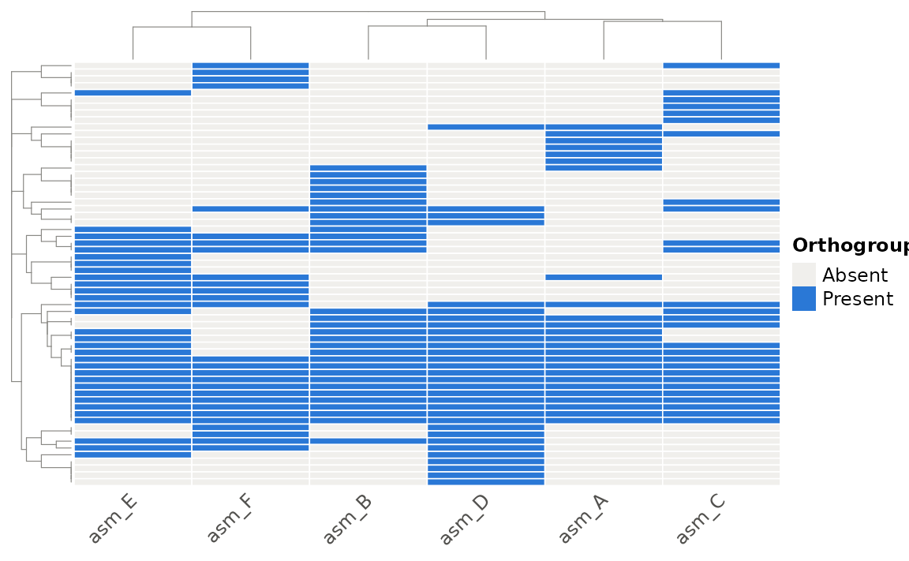

Count and score matrices use a sequential ramp. Scores are drawn in
orange so that a score heatmap is never mistaken for a presence/absence
heatmap. Cells with no protein stay grey.

``` r

plot_heatmap(pa_score)
```

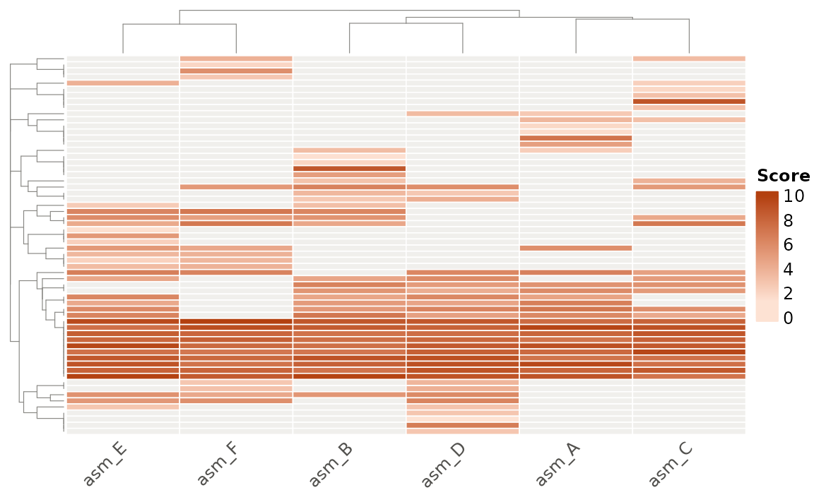

### `pan`: core, accessory and unique

The `pan` style answers the question most people bring to a
presence/absence matrix: which orthogroups are in every assembly, which
are shared by some, and which are found in only one? Rows are split into
**Core** (every assembly), **Accessory** (more than one, not all) and
**Unique** (exactly one) blocks, each with a labelled side bar. Within a
block, rows are still clustered.

``` r

plot_heatmap(pa_binary, style = "pan")
```


On a binary matrix the cells take the class colour, so the three classes
can be read at a glance. On a count or score matrix the cells keep their
magnitude ramp and the blocks carry the class:

``` r

plot_heatmap(pa_score, style = "pan")
```

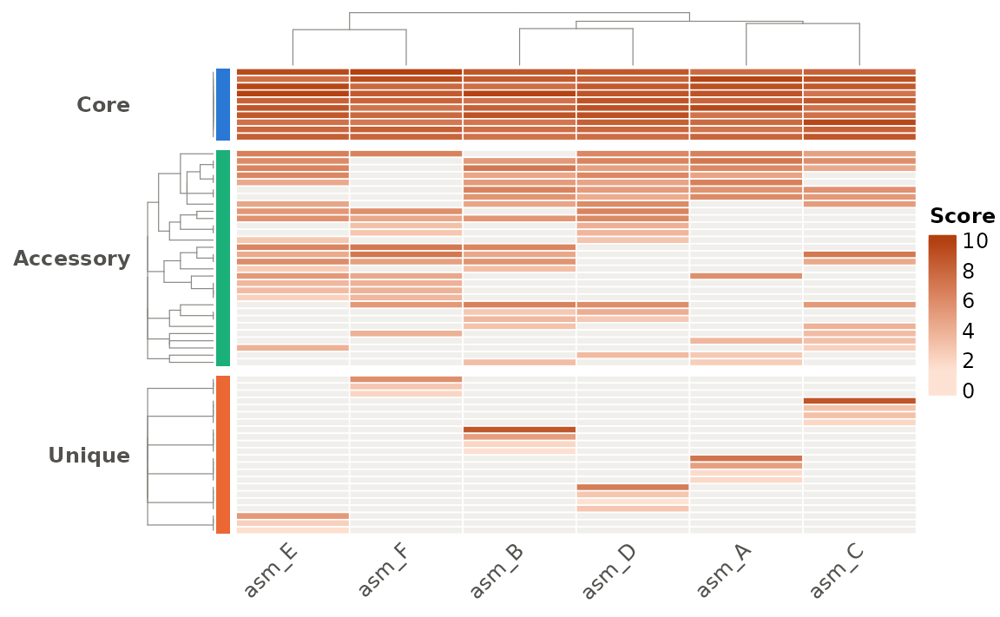

[`plot_pan_structure()`](https://TeamMacLean.github.io/paneffectR/reference/plot_pan_structure.md)
uses finer categories (it separates Rare from Accessory using a
threshold); the heatmap keeps to three classes so the blocks stay
readable.

### `mono`: for print

Black on white with grey grid lines and a frame. Use it for greyscale
figures, supplementary material, or anywhere colour is unavailable.

``` r

plot_heatmap(pa_binary, style = "mono")
```

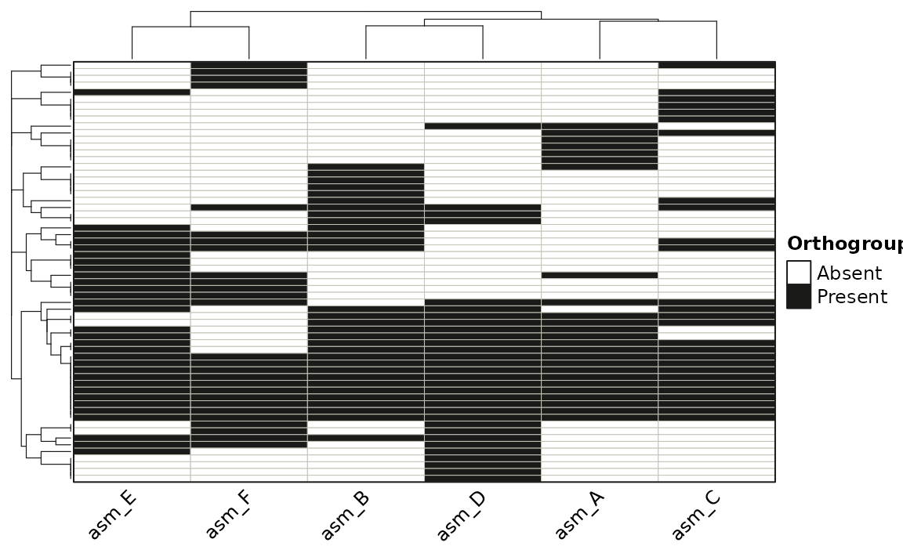

Count and score matrices use a grey ramp in this style.

## Arguments shared by every style

### Clustering and distance

Rows and columns are clustered by default. `distance_method` chooses the
distance: `"binary"` (default), `"jaccard"`, or `"bray-curtis"` (which
also uses the magnitude in count and score matrices). Turn either
dendrogram off to keep the matrix in its original order.

``` r

plot_heatmap(pa_binary, cluster_rows = FALSE, distance_method = "jaccard")
```

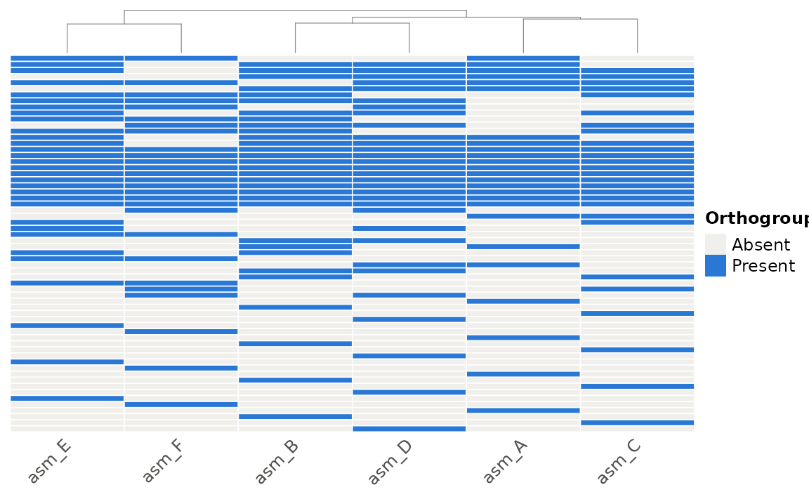

### Row names

Row names are hidden by default because most matrices have too many rows
to label. For a small matrix, or after filtering, turn them on:

``` r

small <- pa_binary[1:12, ]
plot_heatmap(small, show_row_names = TRUE)
```

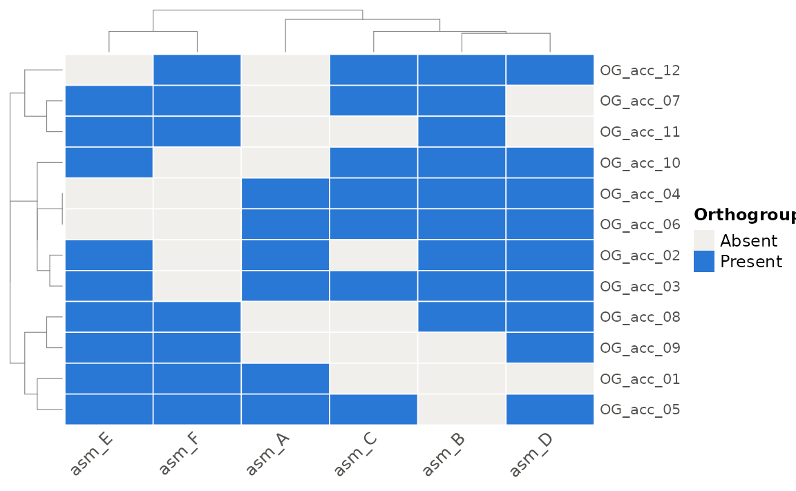

### Your own colours

`color` replaces the cell colours of any style. For binary matrices give
two colours (absent, present); for count and score matrices give a
vector of colours to interpolate, or a
[`circlize::colorRamp2()`](https://rdrr.io/pkg/circlize/man/colorRamp2.html)
function for full control over the breaks.

``` r

plot_heatmap(pa_binary, color = c("grey95", "#6250d6"))
```

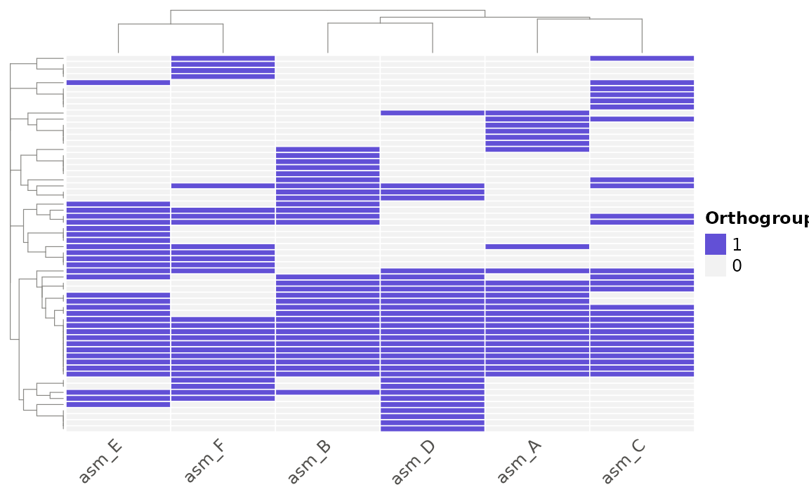

``` r

plot_heatmap(
  pa_score,
  color = circlize::colorRamp2(c(0, 5, 10), c("#f0efec", "#eda100", "#d03b3b"))
)
```

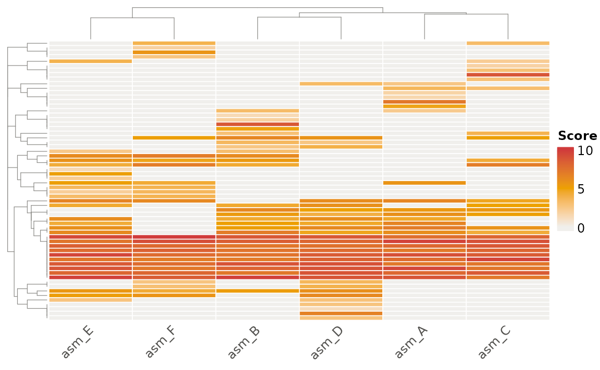

### Annotations

Annotation tracks sit beside the matrix. Give a data frame whose row
names are assembly names (`col_annotation`, drawn on top) or orthogroup
IDs (`row_annotation`, drawn on the left). Each column becomes a track.

``` r

assembly_info <- data.frame(
  row.names = colnames(pa_binary$matrix),
  host = c("wheat", "wheat", "barley", "barley", "rye", "rye"),
  year = c(2015, 2018, 2016, 2019, 2017, 2020)
)
plot_heatmap(pa_binary, style = "pan", col_annotation = assembly_info)
```

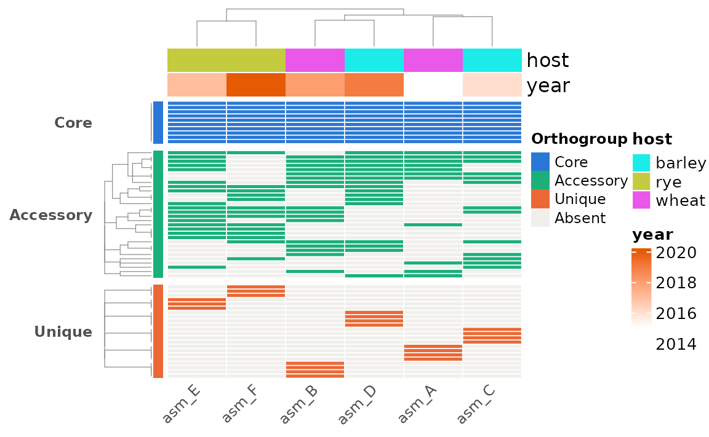

### Large matrices

Above `max_cluster_rows` (5000) rows, the row dendrogram is replaced by
a fast ordering of the distinct presence/absence patterns, and the grid
lines are dropped above 200 rows. For a figure, reduce the matrix first:

``` r

pa_small <- build_pa_matrix(clusters, exclude_singletons = TRUE)
plot_heatmap(pa_small, style = "pan")
```

## Saving a figure

[`plot_heatmap()`](https://TeamMacLean.github.io/paneffectR/reference/plot_heatmap.md)
returns the heatmap without drawing it (printing it at the console draws
it). To save, open a graphics device, draw, and close:

``` r

ht <- plot_heatmap(pa_binary, style = "pan")

png("heatmap.png", width = 7, height = 8, units = "in", res = 300)
ComplexHeatmap::draw(ht)
dev.off()

pdf("heatmap.pdf", width = 7, height = 8)
ComplexHeatmap::draw(ht)
dev.off()
```

Height matters more than width: allow roughly 0.1 inches per row if you
want the grid lines visible, and more if row names are shown.

## Customising beyond the styles

The object
[`plot_heatmap()`](https://TeamMacLean.github.io/paneffectR/reference/plot_heatmap.md)
returns is an ordinary
[`ComplexHeatmap::Heatmap`](https://rdrr.io/pkg/ComplexHeatmap/man/Heatmap.html).
Nothing about it is locked: anything that package can do to a heatmap,
you can do to this one. You do not need to learn ComplexHeatmap to use
paneffectR, but when a figure needs one more thing, it is there.

The simplest route is extra arguments. Anything
[`plot_heatmap()`](https://TeamMacLean.github.io/paneffectR/reference/plot_heatmap.md)
does not recognise is passed to
[`ComplexHeatmap::Heatmap()`](https://rdrr.io/pkg/ComplexHeatmap/man/Heatmap.html)
and overrides the style’s own setting. A few that come up often:

``` r

plot_heatmap(
  pa_binary,
  style = "pan",
  column_title = "Effector orthogroups across six isolates",
  column_names_rot = 90,
  rect_gp = grid::gpar(col = NA)   # no grid lines
)
```

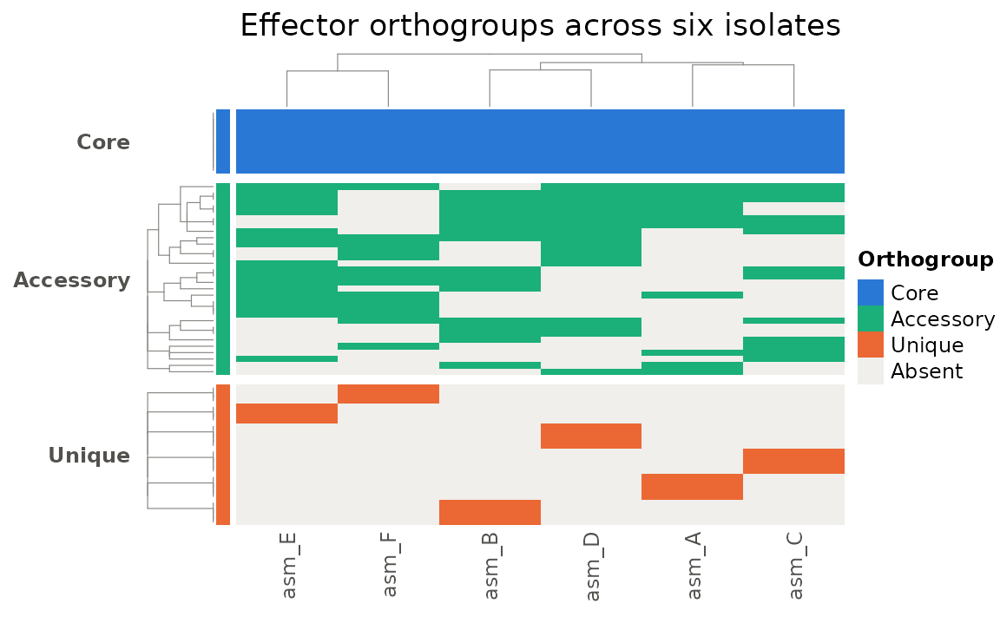

| Argument | Effect |
|----|----|
| `column_title`, `row_title` | Titles along the top or side |
| `column_names_rot` | Angle of assembly labels (0, 45, 90) |
| `column_names_gp`, `row_names_gp` | Font size and colour of labels, e.g. `grid::gpar(fontsize = 7)` |
| `rect_gp` | Cell outline; `grid::gpar(col = NA)` removes the grid |
| `show_row_dend`, `show_column_dend` | Cluster without drawing the dendrogram |
| `width`, `height` | Fix the matrix size, e.g. `grid::unit(8, "cm")` |
| `name` | Legend title |

Beyond arguments, the returned object can be combined with other
heatmaps and annotations using `+`, drawn with a custom legend position
via
[`ComplexHeatmap::draw()`](https://rdrr.io/pkg/ComplexHeatmap/man/draw-dispatch.html),
or inspected with helpers such as
[`ComplexHeatmap::row_order()`](https://rdrr.io/pkg/ComplexHeatmap/man/row_order-dispatch.html)
to recover which orthogroups ended up in which block:

``` r

ht <- ComplexHeatmap::draw(plot_heatmap(pa_binary, style = "pan"))
```

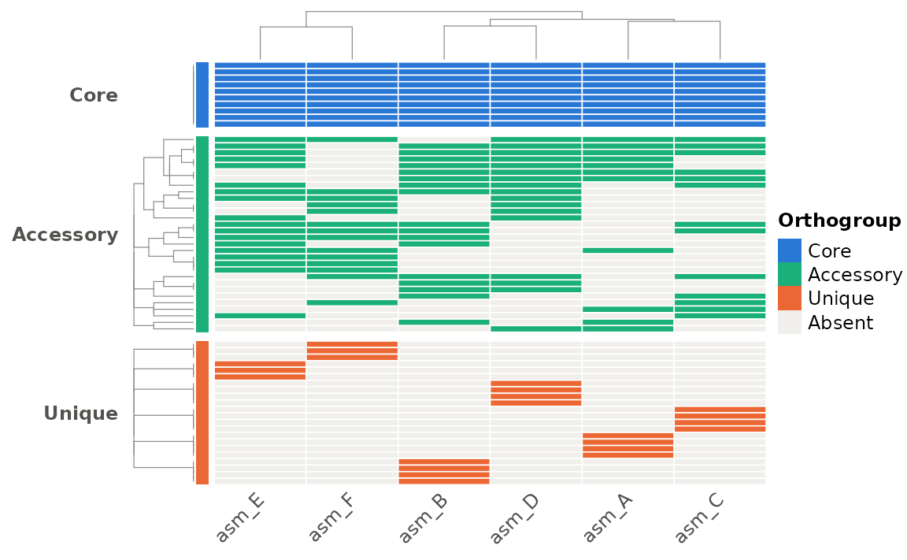

``` r

blocks <- ComplexHeatmap::row_order(ht)
lapply(blocks, function(idx) head(rownames(pa_binary$matrix)[idx]))
#> $Core
#> [1] "OG_core_10" "OG_core_09" "OG_core_08" "OG_core_07" "OG_core_06"
#> [6] "OG_core_05"
#> 
#> $Accessory
#> [1] "OG_acc_05" "OG_acc_03" "OG_acc_15" "OG_acc_02" "OG_acc_14" "OG_acc_04"
#> 
#> $Unique
#> [1] "OG_uniq_06"    "OG_single_006" "OG_single_012" "OG_uniq_05"   
#> [5] "OG_single_005" "OG_single_011"
```

For everything else, the [ComplexHeatmap Complete
Reference](https://jokergoo.github.io/ComplexHeatmap-reference/book/) is
thorough and well organised; the chapter “A Single Heatmap” covers all
the arguments above.
